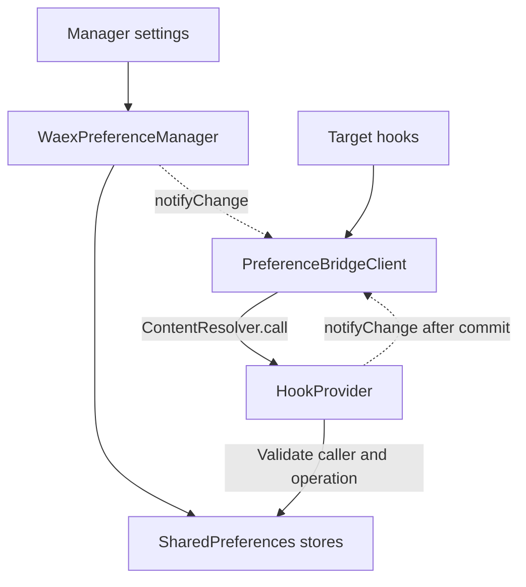

# WAEX preference storage and bridge contracts

This page describes the public implementation checked at
`f6ec7d4e6f47a246ebb413848d66358217fa9c08` on 18 October 2026. Earlier versions of
this page proposed dotted keys, encrypted preferences and a different IPC model.
Those proposals are not a description of the current stores or provider.

## Keys, types and ownership

[PreferenceSchema.java](../app/src/main/java/com/waenhancer/config/PreferenceSchema.java)
records each declared key's type, sensitivity and store. The types are `BOOLEAN`,
`STRING`, `STRING_SET`, `INT`, `LONG` and `FLOAT`. Sensitivity separately determines
whether a setting can be exported: `PUBLIC_SETTING` and `PRIVATE_SETTING` are
exportable; `SECRET`, `CACHE` and `RUNTIME` are not.

The existing persisted identifiers include both current and legacy names.
Examples such as `downloadviewonce`, `seentick`, `dnd_mode` and `dndmode` are actual
storage keys. There is no completed migration to `<category>.<keyName>`. A label
change must not silently rename a stored key or change its declared type.

`PreferenceSchema.Entry` does not contain a default-value or general min/max
validation field. Callers provide defaults and feature-specific policies enforce
any additional ranges or alias precedence. When two generations of a key exist,
check the actual consumer and backup rules instead of assuming they can be
combined with Boolean OR.

## Local storage

[PreferenceStores.java](../app/src/main/java/com/waenhancer/config/PreferenceStores.java)
opens both `waex_prefs` and `private_config` with Android `MODE_PRIVATE`.
`PUBLIC` identifies settings intended for hook transport; it does not mean that
the store is opened using `MODE_WORLD_READABLE`. Older comments that call the
public file world-readable must be interpreted alongside the actual open mode,
the framework integration and provider path.

The manager uses
[WaexPreferenceManager.java](../app/src/main/java/com/waenhancer/core/preferences/WaexPreferenceManager.java)
to select the store, read values and notify the preferences URI after writes.
Some writers return a success value; older void setters do not expose commit
failure. Code consuming those APIs must respect their actual failure contract.

These configuration stores use `SharedPreferences`; they are not implemented
with DataStore or Keystore-backed `EncryptedSharedPreferences` in the public
code. A private file and an Android app sandbox do not promise confidentiality
against a privileged process. Separate cache files are also declared by
`PreferenceStores`.

## Cross-process communication

The provider authority is `com.waenhancer.hookprovider`, and clients observe
`content://com.waenhancer.hookprovider/preferences` for changes.

[HookProvider.java](../app/src/main/java/com/waenhancer/xposed/bridge/HookProvider.java)
is exported in [AndroidManifest.xml](../app/src/main/AndroidManifest.xml).
Its `call` entry checks the Binder caller before clearing the calling identity.
[CallerScopePolicy.java](../app/src/main/java/com/waenhancer/xposed/bridge/CallerScopePolicy.java)
accepts the module UID or a UID associated with a declared target package.
Package-specific reports additionally check ownership of the reported package.
This is UID/package authorization; the provider does not declare a
`signatureOrSystem` permission or authenticate the WhatsApp certificate. The
separate signature permission for restart broadcasts is a different boundary.

For generic preference mutations, the provider validates the complete operation
batch before applying it. It rejects private schema keys and protected derived
state, checks the types of known public keys and applies entitlement checks to
specified enabled premium Booleans. Generic full-store clearing is restricted
to the module UID. The batch limit is 128 operations. See
[PreferenceWriteTypePolicy.java](../app/src/main/java/com/waenhancer/xposed/bridge/PreferenceWriteTypePolicy.java)
and [ProviderDerivedKeyPolicy.java](../app/src/main/java/com/waenhancer/xposed/bridge/ProviderDerivedKeyPolicy.java).
Unknown keys are not all rejected by the schema, so registering a key and testing
its complete path remains necessary.

[PreferenceBridgeClient.java](../app/src/main/java/com/waenhancer/xposed/bridge/client/PreferenceBridgeClient.java)
implements `SharedPreferences` in the target process using a cached provider
snapshot, a serialized executor for writes and a framework disk fallback. Its
getters have explicit coercion/default behavior that can differ from Android's
strict type-mismatch exceptions. `apply()` exposes an optimistic local change;
`commit()` waits for its persistence result. Test refresh/write ordering and
listener behavior explicitly. Successful source compilation alone cannot prove
ordering across Binder calls or disk failure behavior.

## Backups and compatibility

[SettingsBackupCodec.kt](../app/src/main/java/com/waenhancer/core/preferences/SettingsBackupCodec.kt)
encodes a versioned binary `.waex` container and reads supported legacy JSON
forms. It bounds input size, validates typed records and uses an explicit legacy
alias map. The binary container version is not a claim that all preferences have
been migrated to a new naming scheme.

Export uses schema sensitivity to omit secrets and operational state. Import
filters prohibited keys and normalizes supported values, including specified
legacy color representations. Preserve canonical settings when accepting an old
alias; do not infer alias intent solely from similar names. A settings backup is
separate from the databases that hold preserved messages or edit history.

## Regression checks and limits

The public workflow includes checks for caller scope, write types, derived keys,
bridge behavior, backup aliases, binary/JSON round trips and feature/schema
coverage. Relevant entry points include:

- [test_provider_scope.py](../qa/test_provider_scope.py)
- [test_preference_write_types.py](../qa/test_preference_write_types.py)
- [test_provider_derived_keys.py](../qa/test_provider_derived_keys.py)
- [test_bridge_contract.py](../qa/test_bridge_contract.py)
- [test_backup_alias_policy.py](../qa/test_backup_alias_policy.py)
- [test_settings_backup_binary_roundtrip.py](../qa/test_settings_backup_binary_roundtrip.py)
- [test_settings_backup_json.py](../qa/test_settings_backup_json.py)

Read each suite's declared scope. Local doubles, real Android framework fixtures,
a signed APK and a device running an injected host establish different things.
Do not repair a read mismatch by silently clearing preferences or overwriting the
user's settings with defaults.
